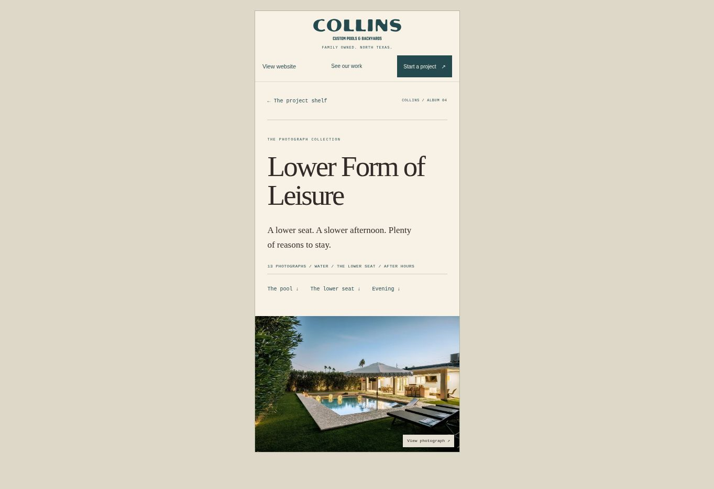

# Lower Form of Leisure

Added 13 unique owner-supplied photographs. One duplicate fireplace portrait was omitted. Originals were preserved; WebP exports keep the supplied aspect ratios and do not upscale.

The blue-hour pool photograph opens the album. Three chapters move through the pool, the sunken lounge, and evening. Captions describe visible details without inventing a location, construction date, or project scope. Existing approval and project metadata remain unchanged.

## Verified

- All 13 exports decode and match their catalog dimensions; photo IDs, cover and chapter references resolve.
- The six albums outside this batch are unchanged.
- Desktop album rendering, the portrait full-screen viewer, arrow-key navigation and Escape dismissal work.
- The 390 × 844 phone review has no horizontal overflow; the project link prefills the album title.
- `git diff --check` and `npm run check:deploy` pass.

The shared inquiry flow still downloads a brief; this change does not add a submission service.

## Mr. Bears, Residence

Added four owner-supplied photos in the same publication batch, without changing the established title or unknown project metadata. The pool facing the illuminated pavilion is the cover; aerial views and a reverse sunset view complete the sequence. Desktop and 390 × 844 phone layouts were visually inspected, with no horizontal overflow. The shared viewer behavior was already checked for this batch.
